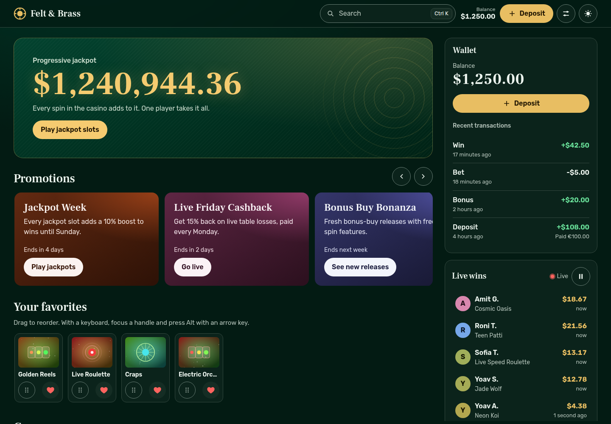

# Felt & Brass: casino lobby



```bash
npm install && npm start   # builds everything, serves it on http://localhost:3000
npm run dev                # Vite + Nest in watch mode, http://localhost:5173
npm run check              # typecheck + lint + 133 unit tests
```

Node 20.19 or newer. `npm start` runs a production build on one origin (SPA, REST and WebSocket), so the service worker works there and not in dev.

## What's in the box

- `apps/web`: React 19 + TypeScript (strict) + Vite. TanStack Query for server state, React Router, no UI kit, CSS modules on top of design tokens.
- `apps/api`: NestJS mock backend. 100 generated games, promotions, a wallet with deposits, a slot machine, and a WebSocket that streams wins and the jackpot.
- `packages/contracts`: the wire types, shared by both sides.

All of §1 and §2 is done: 360 to 1440 without horizontal scroll, light/dark persisted, AA contrast, keyboard and screen reader support, skeleton/empty/error for every async region, filters in the URL, live feed, wallet with the decline path, promotions scroller, i18n, Ctrl/Cmd+K. How to check each one: [docs/RUNBOOK.md](docs/RUNBOOK.md). Riskiest line and the week plan: [docs/NOTES.md](docs/NOTES.md). Demo clip: `docs/demo.zip`.

## Bonus items (§3)

| | Status | Why / how |
|---|---|---|
| H1 Second language | Done | Hebrew with full RTL: logical CSS properties only, mirrored icons, bidi isolation for Latin names inside Hebrew text, Hebrew dual plurals. A pseudo-locale (+40% length) proves layouts survive a longer language. |
| H2 Offline (PWA) | Done | Shell precached. Catalog and promos are network-first with a cache fallback, thumbnails cache-first. The wallet is not cached on purpose: a stale balance that looks current is worse than an error. With nothing cached, a failed fetch shows the section's error state with Retry. |
| H3 Palette that scales | Done | My own scorer: a contiguous match beats a prefix, which beats word starts, which beat scattered letters; gaps and long titles cost points. Games, providers and actions in one ranked list, fully usable from the keyboard, combobox + listbox semantics. |
| H4 Dynamic accent | Done | One CSS variable (`--accent-h`) and OKLCH colors with fixed lightness per theme. A test checks AA for all 36 hues in both themes. Moving the slider re-renders only the slider; the page re-themes through CSS. |
| H5 Jackpot ticker | Done, DOM not canvas | requestAnimationFrame writes into a single text node, interpolating over the server's 2 s tick so the count never stalls. Stops in a hidden tab and snaps on return; reduced motion shows the value without animation. A canvas adds nothing for one number and loses text and screen reader support. |
| H6 Favorites drag | Done | Pointer events (mouse, touch, pen) plus Alt + arrow keys, every move announced, order in localStorage and synced across tabs. Not done: auto-scroll when dragging past the edge of the row. |
| H7 Virtualized feed | Not done, on purpose | The buffer holds 30 wins and the list shows 12. Virtualizing 12 rows costs more than it saves and makes "pause" harder. Worth it once a visible list passes ~100 rows. |
| H8 Tiny game | Done: Brass Sevens | A three-reel slot on the real wallet. The server owns the spin: `POST /api/slot/spins` with an idempotency key takes the bet and pays the win in one step, one `crypto.randomInt` per reel, and a resent key replays the first spin. The client is a state machine (idle → spinning → stopping → idle) that drops any second spin. Reels run on requestAnimationFrame and brake on a curve that only slows down; a win reaches the balance when the last reel lands. A test sums the paytable over all 8 000 stop combinations: exactly 95.80%, the number in the paytable. |

## Three hardest trade-offs

1. **Filtering on the client.** With 100 games it is instant and has no request races. The URL already uses the query parameters a server API would take, so moving to server-side filtering later changes the data source, not the links people share.
2. **Optimistic deposit as an overlay, not a cache write.** Pending deposits are drawn on top of the server wallet. A failed one just stops being pending, so there is no rollback code and two parallel deposits can't undo each other. The price: every wallet snapshot carries a revision and the idempotency key of each deposit in it, so the UI never counts a deposit twice and a late, older answer can't overwrite a newer one. If the connection drops after sending, the client sends the same request again with the same key, and the server replays its first answer instead of crediting twice.
3. **`npm start` builds for production.** Start takes about 10 s longer, but the reviewer sees the real thing: one port, the service worker, hashed assets. `npm run dev` is there for hot reload.
